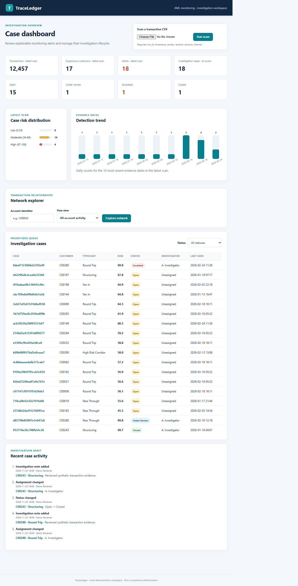
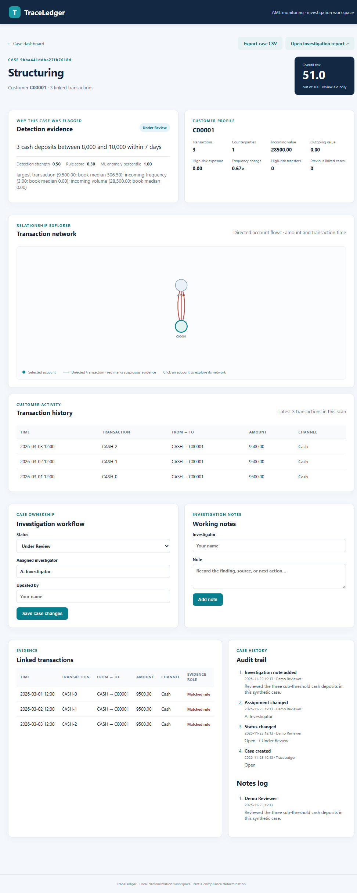
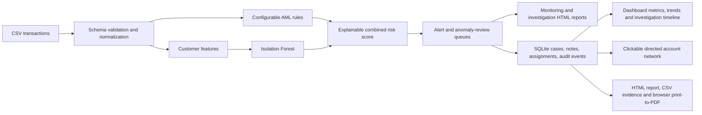

# TraceLedger

**Intelligent AML Monitoring & Financial Investigation System**

TraceLedger is an explainable Python toolkit and local investigation dashboard for transaction monitoring. It combines configurable typology rules, Isolation Forest anomaly scoring, customer risk profiles, transaction-network exploration, and SQLite-backed case management. Synthetic labelled data is included for repeatable demonstrations and evaluation.

[](https://www.python.org/)
[](LICENSE)

> **Educational and research software.** TraceLedger is not a certified AML system, does not determine whether a person has committed wrongdoing, and must not be used as a substitute for an institution's compliance controls.

## Table of contents

- [Overview](#overview)
- [Key features](#key-features)
- [Screenshots and demonstration](#screenshots-and-demonstration)
- [Architecture](#architecture)
- [Technology stack](#technology-stack)
- [AML detection techniques](#aml-detection-techniques)
- [ML anomaly detection and evaluation](#ml-anomaly-detection-and-evaluation)
- [Customer risk scoring](#customer-risk-scoring)
- [Transaction network analysis](#transaction-network-analysis)
- [Investigator workflow](#investigator-workflow)
- [Project structure](#project-structure)
- [Installation](#installation)
- [Configuration and environment](#configuration-and-environment)
- [Run TraceLedger](#run-traceledger)
- [Run tests](#run-tests)
- [Sample output](#sample-output)
- [Limitations and future work](#limitations-and-future-work)
- [Security and data privacy](#security-and-data-privacy)
- [Licence and attribution](#licence-and-attribution)
- [Author](#author)

## Overview

Financial institutions need to identify unusual transaction patterns and give investigators enough context to review them. TraceLedger demonstrates a transparent monitoring pipeline: each rule alert links to its supporting transactions and a readable reason; the ML score is shown separately from rule evidence; and an investigator can review, assign, annotate, and track a case locally.

TraceLedger builds on an existing open-source monitoring foundation, retaining its working rule engine, synthetic-data generator, and command-line workflow while presenting the complete public package, executable, reports, and application under the TraceLedger name.

## Key features

- Six configurable detection rules, including dormant-account reactivation.
- CSV validation with explicit errors for missing values, invalid amounts, and duplicate transaction IDs.
- Evidence transaction IDs and human-readable explanations for rule alerts.
- Separate rule evidence and Isolation Forest anomaly percentile, combined into a 0–100 review-priority score.
- Customer profiles with transaction counts and values, counterparty breadth, high-risk-country exposure, and recent activity change.
- A local dashboard with latest-scan volume, suspicious-customer and alert totals, investigation statuses, case risk distribution, evidence-date trends, and a recent case timeline.
- Case management with investigator assignment, notes, an audit trail, customer transaction history, and downloadable case-evidence CSV.
- Click-through directed transaction networks for account activity, fan-in, fan-out, and detected circular flows, with suspicious evidence highlighted.
- Self-contained monitoring summaries and timestamped HTML investigation reports, with browser print-to-PDF support.
- Deterministic labelled synthetic transactions and customer-level evaluation tools.

## Screenshots and demonstration

Screenshots below were captured from the running TraceLedger dashboard using its synthetic demonstration database.

| Case dashboard | Investigation detail |
|---|---|
|  |  |

The application accepts a transaction CSV, runs monitoring, and saves the evidence and cases in a local SQLite database. See [Run TraceLedger](#run-traceledger) for a complete command sequence.

## Architecture



The command-line monitor and dashboard use the same `Monitor` pipeline. The dashboard persists the uploaded ledger, alert snapshots, case history, and investigator notes locally; it does not call an external service.

## Technology stack

- **Python 3.11+** — package, CLI, monitoring and web application.
- **pandas / NumPy** — transaction normalization, features and metrics.
- **scikit-learn** — `StandardScaler` and `IsolationForest`.
- **Flask** — local investigator dashboard and HTML routes.
- **SQLite** — transaction evidence, cases, notes, assignments and audit history.
- **pytest / Ruff** — tests and linting.

## AML detection techniques

Every alert includes its customer, rule name, strength, evidence transaction IDs, amount, time range, and a concise explanation. Rule thresholds are held in `RuleConfig` and can be overridden with TOML.

| Rule | Pattern reviewed | Default signal |
|---|---|---|
| `structuring` | Repeated cash deposits just below a reporting threshold | At least 3 deposits in the configured amount band and 7-day window |
| `pass_through` | Large inflows forwarded quickly at similar value | At least 3 matched episodes within 48 hours, subject to a forwarded-value share |
| `fan_in` | Many distinct senders paying one account | At least 12 senders of smaller transfers within 7 days |
| `high_risk_corridor` | Transfers involving configured jurisdictions | At least 2 transfers above the configured amount |
| `round_trip` | Time-ordered value returning through a chain of accounts | Cycles within 14 days that retain at least 85% of value per hop |
| `dormant_account` | An unusually large outbound transfer after inactivity | At least 30 inactive days, a $5,000 minimum, and 3× the customer's historical median; 3 prior transactions are required |

Thresholds are illustrative, not legal or regulatory defaults. Configure them for the institution, products, customer segments, and jurisdiction being studied. Alerts from multiple rules are retained as separate rule evidence and combined at customer level for prioritization.

## ML anomaly detection and evaluation

TraceLedger summarizes customer transaction frequency and value, cash and foreign shares, counterparty diversity, largest transaction, flow-through ratio, night activity, high-risk exposure, and activity-frequency change. Skewed numeric fields are log-transformed, standardized, and scored with a deterministic `IsolationForest`. The raw model score is converted to a percentile within the scanned customer population, where larger values are more unusual.

The anomaly percentile is distinct from rule-based alerts. A readable feature comparison accompanies the percentile; it is a **heuristic description**, not a causal explanation or a model-attribution method. Rule evidence and anomaly scores are combined using a configurable weighted risk score. Customers with extreme anomaly percentiles and no rule hit appear in a separate review queue.

When labelled synthetic data is present, `result.evaluate()` reports customer-level precision, recall and F1 plus per-rule/typology measures. `result.threshold_sweep()` evaluates combined-risk cutoffs and includes TP/FP/TN/FN counts; `result.confusion_matrix(threshold=50)` gives a 2×2 customer-level matrix. Threshold sweeps are useful for comparing operating points, not for selecting production thresholds from synthetic results.

The generator labels the five original injected typologies; dormant-account reactivation is covered by focused rule tests but is not currently injected as a synthetic label. The sample aggregate metrics therefore do not measure dormant-account detection.

## Customer risk scoring

Each customer profile includes:

- incoming/outgoing transaction counts and values;
- distinct senders, receivers, and combined counterparty count;
- cash, foreign, night-time, and high-risk-corridor exposure;
- largest transaction and flow-through ratio;
- activity-frequency change between the earlier and later halves of the scanned time period;
- current rule evidence, anomaly percentile, and explanatory feature notes.

The customer score is a 0–100 weighted combination of noisy-OR rule evidence and the ML percentile. It ranks work for review; it is not a probability of money laundering. The case page also displays the number of other persisted cases for that customer as prior investigation context.

## Transaction network analysis

The dashboard's **Network explorer** can show all saved account activity, incoming/fan-in transfers, outgoing/fan-out transfers, or the evidence transactions from a detected round-trip case. Account identifiers are nodes and transfers are directed edges. Click an account node to continue exploring its network in the same scanned dataset. Unique edges are labelled with amounts; hovering an edge reveals its transaction ID, amount, and timestamp. Suspicious rule-evidence edges are highlighted, and a matching evidence table displays each transaction.

The explorer is intentionally bounded to the latest 100 matching transactions for responsive local review. Circular-flow views are based on the round-trip rule's saved evidence, not an unrestricted graph-search engine.

## Investigator workflow

Each `(customer, rule, evidence)` alert is stored as a case with a stable identifier. Investigators can:

1. Review the detection reason, supporting transactions, customer profile, and network path.
2. Set status to **Open**, **Under Review**, **Escalated**, or **Closed**.
3. Review the customer's recent transaction history, assign the case to an investigator, and add timestamped investigation notes.
4. Review the audit trail for case creation, status changes, assignments, and notes.
5. Export case evidence as CSV or open a self-contained HTML investigation report with current case details, customer context, evidence, network, notes, case status, and report-generation time. Use the report's **Print / save as PDF** control to save a PDF from the browser.

The customer history view shows up to the latest 200 transactions from the case's dataset. CSV export contains the case evidence transactions and their evidence role. PDF creation uses the browser's print dialog; TraceLedger does not depend on a server-side PDF renderer. SQLite persistence is local to the machine. This portfolio demo does not include user accounts, role-based permissions, or multi-user concurrency controls.

## Project structure

```text
traceledger/
  __init__.py, cli.py, __main__.py  Public package and CLI entry points
  config.py, schema.py, rules.py    Thresholds, validation and six AML rules
  synth.py                          Labelled synthetic transaction generator
  scoring.py, evaluate.py           Customer features, ML scoring and evaluation
  monitor.py, report.py             Monitoring pipeline and HTML summary report
  cases.py, web.py                  SQLite investigation store and Flask routes
  templates/, static/               Dashboard, case, network and report views
examples/                           TOML rules and Python quickstart
tests/                              Rule, schema, pipeline, case-store and web tests
docs/screenshots/                   Genuine dashboard and case-detail screenshots
```

Use the `traceledger` package and CLI for all development and execution.

## Installation

Python 3.11 or newer is required.

```powershell
# From the TraceLedger repository root:
python -m venv .venv
.\.venv\Scripts\Activate.ps1
python -m pip install -e ".[dev]"
```

On macOS or Linux, activate the environment with `source .venv/bin/activate` after creating it. The project metadata in `pyproject.toml` installs the runtime dependencies, web dashboard, CLI entry point, and optional development tools.

## Configuration and environment

Copy and edit [`examples/rules.toml`](examples/rules.toml) to calibrate detection thresholds. For example:

```toml
reporting_threshold = 10000
structuring_min_count = 3
dormant_inactive_days = 30
dormant_min_amount = 5000
dormant_amount_multiplier = 3
dormant_min_history = 3
high_risk_countries = ["ZZ", "ZY"]  # placeholders: replace with your policy list

[weights]
structuring = 0.6
dormant_account = 0.6
```

The CLI scan accepts `--config path\to\rules.toml`. The dashboard currently uses the default `RuleConfig`. The SQLite database path defaults to `traceledger.db`; override it with `--db` or the `TRACELEDGER_DB` environment variable:

```powershell
$env:TRACELEDGER_DB = "C:\data\traceledger-demo.db"
python -m traceledger serve
```

No API keys or external service credentials are required. The dashboard has no secret-bearing configuration.

## Run TraceLedger

Generate a deterministic synthetic ledger and scan it from the command line:

```powershell
python -m traceledger generate --out transactions.csv --customers 1000 --days 90 --seed 42
python -m traceledger scan transactions.csv --config examples/rules.toml --report report.html --alerts alerts.csv
```

Start the local dashboard, then open <http://127.0.0.1:5000>:

```powershell
python -m traceledger serve
```

Upload `transactions.csv` from the dashboard to create cases. The default server binds to `127.0.0.1`; use `--host` only if you understand the security implications. `python -m traceledger --help` lists commands.

## Run tests

```powershell
python -m pytest -q
python -m ruff check traceledger tests
```

The tests cover all AML rules, dormant-account thresholds, schema validation including missing values and duplicate IDs, end-to-end synthetic evaluation, score bounds and thresholds, SQLite case persistence/audit behavior, and Flask upload/investigation/report routes.

## Sample output

The following is output from the included default synthetic scenario (1,000 customers, 90 days, seed 42) run during this project update:

```text
Scanned 60,116 transactions across 1,000 customers
Alerted customers: 53  |  anomaly review: 3
  round_trip              23
  pass_through            14
  fan_in                   9
  high_risk_corridor       8
  structuring              7
Against labels: precision 0.89, recall 1.00, F1 0.94
```

In the same run, the combined-risk threshold sweep produced (rounded):

| Risk cutoff | Precision | Recall | F1 | TP | FP | TN | FN |
|---:|---:|---:|---:|---:|---:|---:|---:|
| 20 | 0.139 | 1.000 | 0.245 | 47 | 290 | 663 | 0 |
| 40 | 0.887 | 1.000 | 0.940 | 47 | 6 | 947 | 0 |
| 60 | 1.000 | 0.638 | 0.779 | 30 | 0 | 953 | 17 |
| 80 | N/A | 0.000 | N/A | 0 | 0 | 953 | 47 |

At cutoff 50 the measured confusion matrix was **TN=953, FP=0, FN=1, TP=46**. These metrics come from injected synthetic labels and must not be read as expected performance on real financial data. Different library versions or configuration changes can change results.

## Limitations and future work

- Synthetic labels encode known injected patterns and cannot represent adaptive real-world laundering or production prevalence.
- Isolation Forest is unsupervised and population-relative; its percentile can change when the scanned customer book changes.
- Risk scores and explanations are triage aids, not calibrated probabilities, legal conclusions, or model-attribution explanations.
- Detection thresholds and placeholder high-risk-country codes require institution-specific review.
- Network exploration is bounded and does not provide a general-purpose graph database or exhaustive path search.
- The dashboard is a local, single-user portfolio application without authentication, authorization, encryption at rest, or deployment hardening. CSV exports may contain sensitive transaction details; store and handle them with the same care as the source ledger.
- Further work could add customer segmentation, richer graph search, reviewed-label feedback, and production-grade access control and audit retention.

## Security and data privacy

Use the built-in synthetic generator for demonstrations. Uploaded CSV transactions and case details are stored in the local SQLite database (`traceledger.db` by default), which is ignored by Git but **is not encrypted**. Do not upload real customer or confidential financial data to this portfolio demo.

The development server binds to loopback by default and makes no external API calls. It has no authentication or authorization: do not expose it to a public or shared network. Follow your organization's data protection, retention, access, and regulatory requirements for any real monitoring system.

## Licence and attribution

TraceLedger retains the MIT licence and original copyright attribution in [`LICENSE`](LICENSE). The monitoring engine is derived from the open-source [AMLWatch project by Rudy Sinon](https://github.com/rsinon/amlwatch); its attribution and licence are preserved. TraceLedger's rebrand and enhancements do not imply endorsement by the original author.

## Author

**Developed by Aayush Hudda**

B.Tech Computer Science and Engineering

National Institute of Technology, Surat

- GitHub username: [Aayush1554](https://github.com/Aayush1554)
- GitHub profile: [github.com/Aayush1554](https://github.com/Aayush1554)
- LinkedIn: [Profile URL to be added](#linkedin-profile-url-placeholder)
- Email: [aayush154837@gmail.com](mailto:aayush154837@gmail.com)

### LinkedIn profile URL placeholder

Add the author's LinkedIn profile URL here before publishing.
